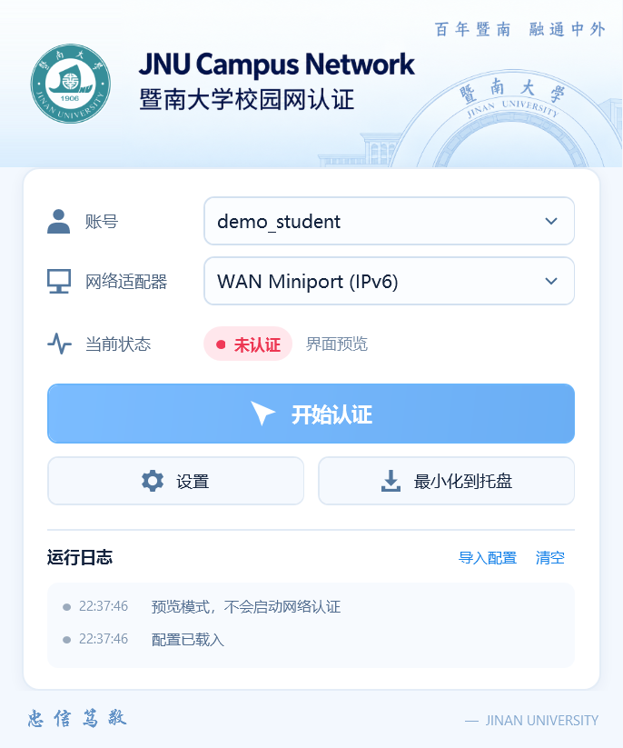
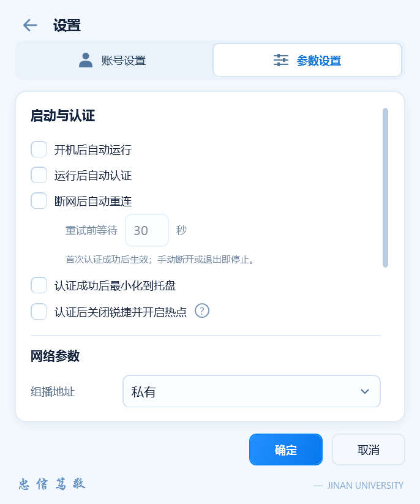

# MentoHUST4JNU

为暨南大学锐捷 6.61 认证环境提供 WPF 桌面界面，基于 [Hjdd14/mentohust-windows-jnu](https://github.com/Hjdd14/mentohust-windows-jnu) 开发。通过独立 C++ 后台复用原认证核心，账号与参数继续兼容旧配置。

本仓库是由 [1nvincibleZz](https://github.com/1nvincibleZz) 独立维护的 MentoHUST4JNU 版本。WPF 界面、开机自动认证、热点辅助和单文件打包在此维护与发布；认证核心沿用原项目，保留原作者署名、版权声明和提交历史。本版本不代表上游官方发布。

## 界面

| 首页 | 参数设置 |
| --- | --- |
|  |  |

## 功能

- 单窗口首页与设置页，圆角控件、柔和图标、高清页眉和校徽；程序、窗口及托盘使用官网 SVG 生成的透明多尺寸图标。
- 平滑切页、滑动标签与复选框过渡；动画结束清理资源，保留键盘操作。
- 账号管理只填写账号和密码，网卡选择、认证状态及运行日志同步显示。
- 旧版 INI 导入、草稿取消、兼容保存、外部修改检测和上一份配置备份。
- 手动开始／断开认证；可选启动后自动认证，认证成功后可等待半秒收起到托盘。
- 开机自启动与开机自动认证：登录 Windows 后自动打开程序，等待网卡就绪后使用已保存的账号连接校园网。
- 可选断网后自动重连：首次认证成功后监测所选网卡，等待链路恢复后重试；手动断开或退出即停止。
- 可选认证后结束 `8021x.exe` 一次并启动 Windows 移动热点，问号提供说明。

## 下载与使用

### 1. 下载程序

打开 [Release 下载页面](https://github.com/1nvincibleZz/JNU-MentoHUST-BetterUI/releases)，下载 `MentoHUST4JNU-版本号.zip`。

当前正式版：[v1.0.3](https://github.com/1nvincibleZz/JNU-MentoHUST-BetterUI/releases/tag/v1.0.3)，下载 `MentoHUST4JNU-v1.0.3.zip`。

请下载程序 ZIP，日常使用不需要下载 GitHub 自动提供的 `Source code`。

将 ZIP 解压到一个固定文件夹，再打开 `MentoHUST4JNU.exe`。压缩包只有主程序和 `README.txt`，认证后台已包含在主程序里，不需要另外打开第二个 EXE。

### 2. 准备运行环境

本版已在 Windows 11 上验证。首次使用的电脑可能需要安装以下组件，已经安装的无需重复安装：

- **Npcap 抓包驱动**：认证需要使用。到 [Npcap 官网](https://npcap.com/#download) 下载，安装时勾选 **Install Npcap in WinPcap API-compatible Mode**。
- **微软 Visual C++ 运行库（x86）**：如果程序提示缺少运行库或 DLL，请从 [微软官方页面](https://learn.microsoft.com/en-us/cpp/windows/latest-supported-vc-redist) 下载并安装 **X86** 版本。即使电脑是 64 位 Windows，也请选择 X86。

Windows 11 已自带所需的 .NET Framework，不需要安装 Visual Studio、Python 或 .NET 8，也不需要自己编译源码。

### 3. 连接校园网

1. 连接校园网网线，打开主程序。
2. 点击“设置”，填写校园网账号和密码。
3. 点击“添加 / 更新”，再点击“确定”。
4. 回到首页，选择账号和联网网卡。使用网线时，通常选择“以太网”对应的网卡。
5. 点击“开始认证”，看到“已认证”后即可使用校园网。

已有旧版配置的用户，也可以点击“导入配置”，选择原来的 `Config.ini`。

### 4. 开机自动连接

先手动认证成功一次，再打开“设置 → 参数设置”：

- 勾选“开机后自动运行”。
- 勾选“运行后自动认证”。
- 点击“确定”。

下次登录 Windows 时，程序会自动打开，等待网卡准备好后自动认证。

请将程序保存在固定文件夹。如果移动了程序，请从新位置打开，并重新保存一次开机运行设置。

### 5. 收起窗口与热点

勾选“认证成功后最小化到托盘”，认证成功后会稍等半秒再收起。点击任务栏右下角的程序图标，可以重新打开窗口。

需要认证后开启热点时，可以勾选对应选项，旁边的问号提供功能说明。热点名称和密码在 Windows 的“移动热点”设置中修改。

如果热点操作提示权限不足，请关闭程序，再右键选择“以管理员身份运行”。

### 6. 断网后自动重连

在“设置 → 参数设置”勾选“断网后自动重连”，点击“确定”。默认重试前等待 30 秒，可以调整为 5–300 秒。

首次认证成功后开始监测。拔掉网线时会等待，重新插好后再尝试；原后台正在恢复时，会额外给它约 90 秒时间。重连沿用本次连接的账号和网卡，不重复执行关闭锐捷和开启热点。

点击“断开认证”或“取消重连”，或退出程序，就会停止自动重连。收起到托盘后仍然有效。这个选项默认关闭，与“运行后自动认证”分别设置。

维护者已在自己的电脑上实测：设备管理器禁用后恢复联网网卡，客户端自动恢复认证，状态和“断开认证”按钮显示正常。

## 构建

已有 Windows .NET Framework 4.x 编译器时，用 PowerShell 构建前端；后台需要 Visual Studio C++、MFC x86 工具链和 Windows SDK。将 `VisualStudioRoot` 改为本机安装目录：

```powershell
pwsh -File .\desktop-wpf\build-single-file.ps1 -VisualStudioRoot 'D:\MicrosoftVisualStudio'
.\desktop-wpf\bin\SingleFile\MentoHUST4JNU\MentoHUST4JNU.exe
```

单文件构建先生成后台再嵌入前端，输出双文件 ZIP（主程序及 README）。已有后台时可用 `-EngineExecutable` 指定它；嵌入过程不修改后台字节。开发时仍可分别运行 `build-preview.ps1` 与 `build-engine.ps1`。开发构建和发布包统一使用 `MentoHUST4JNU.exe`，正常运行会连接认证后台；`--preview` 才是只在内存中操作的离线界面预览。

另提供 .NET 8 Windows 工程：

```powershell
dotnet build .\desktop-wpf\MentoHUST.Desktop.csproj
```

当前验证的是 .NET Framework 构建路径，.NET 8 SDK 构建尚未在本机验证。

## 开发与验证

- [WPF 构建、功能和检查命令](desktop-wpf/README.md)
- [认证后台桥接与迁移边界](desktop-wpf/MIGRATION.md)
- [界面素材来源](desktop-wpf/Assets/README.md)
- [本版更新内容](CHANGELOG.md)

原 `VS2012/MentoHUST` 工程与认证核心保留，`references/` 是历史参考。原 Windows MentoHUST 来源见 [Google Code 存档](https://code.google.com/archive/p/mentohust/issues/51)。


## 致谢❤
感谢 :octocat: [Hjdd14/mentohust-windows-jnu](https://github.com/Hjdd14/mentohust-windows-jnu) 的开源
